# Chapter 14: Indexing 索引

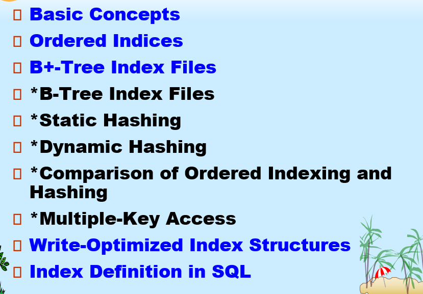

## 1. 基础概念

**作用**: 加速对所需数据的访问速度

**搜索键**(search key): 搜索键是用于在文件中查找记录的一个**属性**或**一组属性**

**索引文件结构**: 由许多索引项构成

- 一般远小于源文件

两种索引: 

- 顺序索引 (Ordered indices): 搜索键按顺序存储
- 散列索引 (Hash indices): 使用哈希函数, 将搜索键转换为哈希值, 指向存储数据的 **桶**

索引评价因素:

- 能有效支持的存取类型
  - 等值查询
  - 范围查询
- 访问时间
- 插入时间
- 删除时间
- 空间开销

## 2. 顺序索引

索引项 被按照搜索键的排序存储

**顺序排序文件**: 记录按照搜索键顺序存储

**主索引**: 如果一个索引的搜索键，正好也是该**顺序排序数据文件**的排序依据，那么这个索引就称为**主索引**

- 也叫做 **聚集索引 clustering index**
- 主索引的搜索键**通常是但并非一定是**主码

- **索引顺序文件**: 有主索引的索引顺序文件

**辅助索引 secondary index**: 索引的排序方式与数据文件的物理存储顺序**不一致**

- 也叫做 **非聚簇索引**

顺序索引的两种类型:

- 稠密索引
- 稀疏索引

### 2.1. 稠密索引文件

稠密索引: 对于数据文件中的**每一个**搜索键值，索引文件中都有一个对应的索引项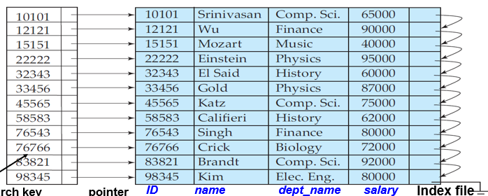

### 2.2 稀疏索引文件

稀疏索引: 索引文件中只为数据文件中的**部分**搜索键值建立索引项

- 通常是一个数据块建立一个索引

- 稀疏索引**只适用于数据文件已按搜索键顺序排列**的情况

如何查找记录:

1. 在索引文件中找到**小于或者等于K的最大搜索键值**
2. 从那个物理位置开始, 在数据文件中顺序向下扫描

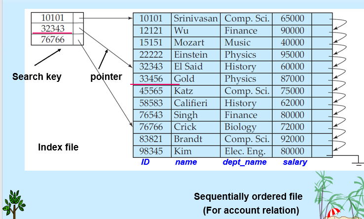

优点: 相比于稠密索引, 插入与删除的空间和维护负担更小

缺点: 通常比稠密索引在查找记录时慢

### 2.3 辅助索引

索引结构: 辅助索引通常为每个搜索键值建立一个索引项

索引项指向一个**桶**, 这个桶里装着指针, 每个指针指向一条符合条件的实际数据记录

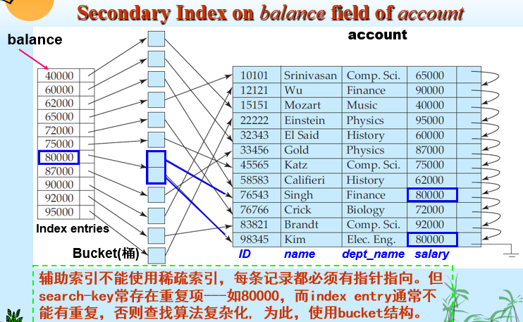

### 2.4 多级索引

若主索引太大无法放入内存, 访问费用会变得十分昂贵

**基本思想**: 既然索引文件也是一个“顺序文件”，那我们**为索引文件再建一个稀疏索引**

- 外层索引: 主索引的稀疏索引
- 内层索引: 主索引的顺序文件

可以推广到任意多层索引

所有层级的索引在插入或删除文件时都必须更新

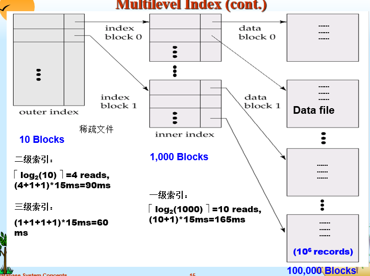

多级索引技术可应用于聚集索引和非聚集索引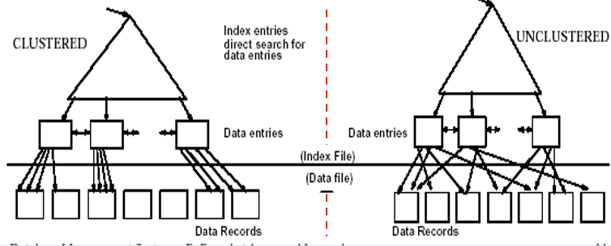

### 2.5 索引更新: 删除

1. 系统找到数据文件中的记录, 然后删除这个记录
2. 更新索引文件:
   1. 稠密索引: 
      - 若search key具有唯一性, 直接删除对应的索引项
      - 若search key不具有唯一性
        - 若索引项存储的是一串指针, 直接删除一个指针即可1
        - 若指向第一条记录: 若删除的是中间或后面, 不动; 若恰好删除第一个, 更新索引项
   2. 稀疏索引:
      - 如果不在索引中, 则不需要做任何操作
      - 若在索引中, 则用数据文件中的下一项代替; 若下一项已经存在, 则直接删除
3. 对于多级索引: 由底层逐级向上层扩展

### 2.6 索引更新: 插入

利用索引找到插入位置, 在数据文件中插入记录

- 单层索引插入:
  - 稠密索引
    - 若搜索键值未出现在索引中, 将其插入
    - 若存在: 如果使用多指针, 直接添加一个指针; 否则, 不用做处理
  - 稀疏索引: 假设一个数据块有一个索引项
    - 如果新块被创建, 插入新块中的第一个搜索键值
    - 若新纪录是它的块中的最小值, 更新索引项
    - 其它, 不用做处理
- 多级插入, 对单层插入做简单扩展

---

## 3. B+树索引文件

索引顺序文件的缺点:

- 文件增长后会产生许多溢出块
- 性能会逐渐下降
- 需要周期性地重组整个索引文件

**B+树索引**是索引顺序文件的替代方案。

优点:

- 面对插入和删除时, 能通过小范围的局部调整自动重组。
- 不需要为了维持性能而重组整个文件。
- 在数据库系统中使用非常广泛。

缺点:

- 插入和删除有额外开销。
- 有一定空间开销。

### 3.1 B+树的性质

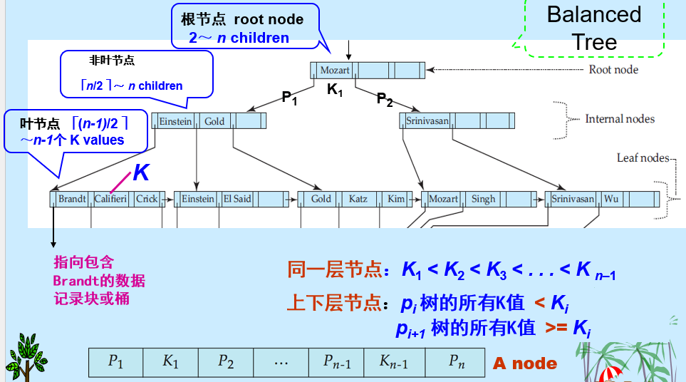

B+树是一棵有根树, 满足:

- 从根到所有叶节点的路径长度相同, 因而是平衡树。
- 设节点最大指针数为 `n`。
- 非根非叶节点有 `ceil(n/2)` 到 `n` 个子节点。
- 叶节点有 `ceil((n-1)/2)` 到 `n-1` 个搜索键值。

特殊情况:

- 若根不是叶节点, 至少有 2 个子节点。
- 若根本身是叶节点, 可以有 0 到 `n-1` 个搜索键值。

### 3.2 B+-Tree Node Structure B+树节点结构

一个典型节点包含:

- 搜索键值 `K1, K2, ..., Kn-1`
- 指针 `P1, P2, ..., Pn`

**指针含义**:

- 在非叶节点中, 指针指向子节点。
- 在叶节点中, 指针指向记录或记录桶。

通常一个 B+树节点对应一个磁盘块。

节点中的搜索键有序:

```text
K1 < K2 < K3 < ... < Kn-1
```

### 3.3 Leaf Nodes in B+-Trees B+树叶节点

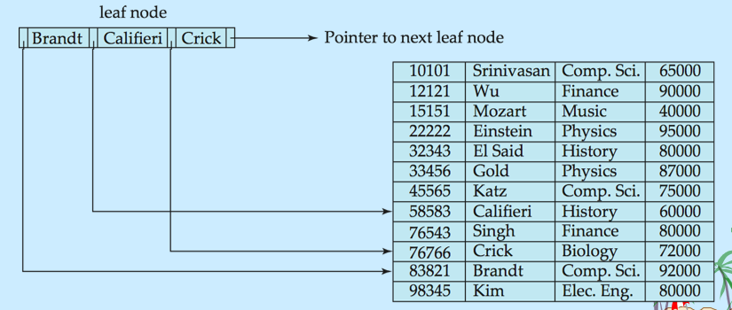

叶节点中的指针:

- 对于 `i = 1, 2, ..., n-1`, 指针 `Pi` 指向搜索键值为 `Ki` 的文件记录。
- 若搜索键不是主码, `Pi` 可以指向一个桶, 桶中保存所有对应记录的指针。

叶节点特点:

- 叶节点之间按照搜索键顺序排列。
- 若 `Li` 和 `Lj` 是叶节点且 `i < j`, 则 `Li` 中所有搜索键值都小于 `Lj` 中所有搜索键值。
- `Pn` 指向下一个叶节点, 便于顺序扫描和范围查询。

叶节点至少半满:

- 必须有 `ceil((n-1)/2)` 到 `n-1` 个搜索键。
- 例如 `n = 5` 时, 每个叶节点有 2 到 4 个搜索键。

### 3.4 Non-Leaf Nodes in B+-Trees B+树非叶节点

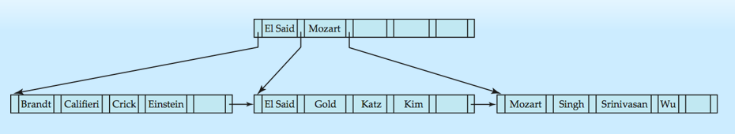

**扇出数**(fanout): 一个节点中的指针数量。

非叶节点:

- 有 `ceil(n/2)` 到 `n` 个指针。
- 形成对叶节点的多级稀疏索引。

注意:

- 非叶节点中的指针是指向节点的地址, 不是指向节点中某个值的地址。
- B+树中, 非叶节点的搜索键可以与叶节点中的搜索键重复。

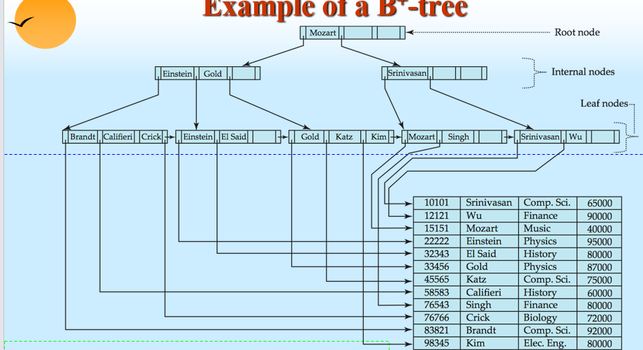

### 3.5 Observations about B+-trees

- 节点之间通过指针连接, 逻辑上相邻的块不一定物理上相邻。
- 非叶节点层级构成多级稀疏索引。
- B+树层数通常很少, 大小与主文件规模呈对数关系。
- 插入和删除可以在对数时间内完成索引结构调整。

---

## 4. Queries on B+-Trees B+树查询

查找搜索键值为 `k` 的所有记录:

1. 从根节点开始。
2. 在当前节点中寻找**大于 `k` 的最小搜索键值**。
3. 若存在这样的键值 `Vi`, 沿着它左侧对应的指针 `Pi` 进入子节点。
4. 若不存在, 说明 `k` 大于等于当前节点中的最大键值, 沿最右指针进入子节点。
5. 如果到达的节点不是叶节点, 重复上述过程。
6. 到达叶节点后:
   - 若存在 `Vi = k`, 沿 `Pi` 找到记录或桶。
   - 否则不存在搜索键值为 `k` 的记录。

**B+树查询代价**:

- 一次查询会从根到某个叶节点走一条路径。
- 若文件中有 `M` 个搜索键值, 路径长度不超过$\ceil{log_{\lceil n/2 \rceil}M}$
- 一个节点通常等于一个磁盘块, 大小约 4KB
- `n` 通常约为 100

例:

- 若有 100 万个搜索键值, `n = 100`, 则从根到叶最多访问约 4 个节点。
- 平衡二叉树查找 100 万个值大约需要访问 20 个节点。
- 因为每个节点访问可能对应一次磁盘 I/O, 所以这种差异很重要

---

## 5. Updates on B+-Trees B+树更新

### 5.1 Insertion 插入

插入步骤:

1. 找到搜索键值应该出现的叶节点。
2. 若搜索键值已经在叶节点中:
   - 将记录加入数据文件。
   - 若需要桶结构, 将新记录指针加入桶中。
3. 若搜索键值不在叶节点中:
   - 将记录加入数据文件。
   - 必要时创建桶。
   - 更新 B+树。

叶节点有空位:

- 将 `(pointer, key-value)` 对按照搜索键顺序插入叶节点。

叶节点已满:

- 需要分裂叶节点。

### 5.2 Splitting a Leaf Node 分裂叶节点

分裂叶节点的过程:

1. 将原有键值对和待插入键值对合在一起, 按搜索键排序。
2. 设共有 `m` 个键值对。
3. 前 `ceil(m/2)` 个保留在原节点。
4. 剩余键值对放入新节点。
5. 设新节点为 `p`, 新节点中最小搜索键值为 `k`。
6. 将 `(k, p)` 插入父节点。
7. 若父节点已满, 继续分裂父节点并向上传播。

叶节点分裂时:

- 新节点中的最小键值会被**复制到父节点**。
- 该键值仍然保留在叶节点中。

### 5.3 Splitting a Nonleaf Node 分裂非叶节点

分裂非叶节点时:

- 子指针被分配到原节点和新节点中。
- 与左侧指针相关的搜索键保留在左节点。
- 与右侧指针相关的搜索键放入右节点。
- 位于左右两部分之间的中间搜索键不放入任何一个分裂后的节点。
- 该中间键值连同指向新节点的指针插入父节点。

非叶节点分裂时:

- 中间键值会被**移动到父节点**。
- 该键值不再保留在原非叶节点或新非叶节点中。

插入可能一直向上传播:

- 节点分裂会持续向上, 直到遇到未满的节点。
- 最坏情况下根节点也会分裂。
- 根节点分裂会使 B+树高度增加 1。

### 5.4 Deletion 删除

删除步骤:

1. 找到要删除的记录, 并从主文件中删除。
2. 若存在桶, 从桶中删除该记录指针。
3. 若没有桶, 或删除后桶变空, 则从叶节点中删除对应的 `(pointer, search-key value)`。
4. 若叶节点删除后键值太少, 需要调整结构。

叶节点下溢:

- 若当前节点和相邻兄弟节点的键值可以合并到一个节点中:
  - 将两个节点中的搜索键值放到一个节点中。
  - 删除另一个节点。
  - 从父节点中删除指向被删除节点的项。
  - 该过程可能递归向上。
- 若当前节点和兄弟节点无法合并到一个节点中:
  - 在当前节点和兄弟节点之间重新分配搜索键值和指针。
  - 更新父节点中对应的搜索键值。

删除可能向上传播:

- 若父节点也因为删除而指针数不足, 继续调整。
- 若根节点删除后只剩一个指针, 删除根节点, 其唯一子节点成为新的根。

### 5.5 B+-Tree File Organization B+树文件组织

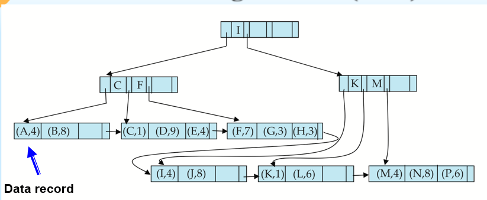

B+树索引解决的是索引文件退化问题。

B+树文件组织解决的是数据文件退化问题。

在 B+树文件组织中:

- 叶节点存储的是数据记录本身, 而不是记录指针。
- 因为记录比指针大, 叶节点能存放的记录数少于非叶节点能存放的指针数。
- 叶节点仍要求至少半满。
- 插入和删除方式与 B+树索引中的条目插入、删除类似。

空间利用率很重要:

- 因为叶节点存放数据记录, 空间浪费代价更高。
- 为提高空间利用率, 可以在分裂和合并时让更多兄弟节点参与重分配。

---

## 11. Write Optimized Indices 写优化索引

B+树在写密集负载下可能性能较差:

- 若内部节点都在内存中, 每次插入仍可能需要一次叶节点 I/O。
- 在磁盘上, 每个磁盘每秒插入次数可能少于 100。
- 在闪存上, 每次插入可能需要重写一个页面。

降低写成本的两种方法:

- Log-Structured Merge Tree, LSM 树
- Buffer Tree, 缓冲树

### 11.1 Log Structured Merge Tree LSM树

先只考虑插入和查询。

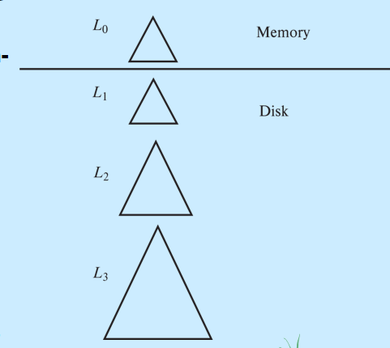

LSM 树基本思想: **将离散的随机写操作转化为批量的顺序写操作**

- 新记录先插入内存树 `L0`。
- 当内存树满时, 将记录移动到磁盘树 `L1`。
- 构造 `L1` 时, 通过自底向上构建方式, 将已有 `L1` 和 `L0` 中记录合并。
- 当 `L1` 超过阈值时, 合并到 `L2`。
- 可以继续扩展更多层。
- `Li+1` 的大小阈值通常是 `Li` 的 `k` 倍。

LSM 优点:

- 插入主要使用顺序 I/O。
- 叶节点较满, 减少空间浪费。
- 与普通 B+树相比, 每条插入记录需要的 I/O 次数减少。

LSM 缺点:

- 查询需要搜索多棵树。
- 每层内容在合并中可能被多次复制。

**阶梯合并索引**(stepped-merge index):

- LSM 树变体，每一层可以有多棵树，写成本比 LSM 更低，查询更昂贵

删除:

- 通过插入特殊的 delete entry 处理。
- 查询时若同时找到原条目和删除条目, 只返回没有匹配删除条目的记录。
- 合并树时, 若删除条目匹配原条目, 二者都丢弃。

更新:

- 类似删除, 插入 update entry。

应用:

- LSM 最初用于磁盘索引。
- 也适合减少闪存擦除。

### 11.2 Buffer Tree 缓冲树

缓冲树是 LSM 树的替代方案。

核心思想:

- B+树的每个内部节点都有一个缓冲区, 用来暂存插入
- 当缓冲区满时, 才将插入批量移动到下一层
- 缓冲区越大, 每次下推的记录越多
- 平均到每条记录上的 I/O 成本降低

优点:

- 查询开销比 LSM 小。
- 可以用于任意树索引结构。

缺点:

- 比 LSM 有更多随机 I/O。

插入:

- 不直接一路插到叶节点。
- 先把索引记录插入根节点缓冲区。
- 若缓冲区满, 将其中记录按搜索键排序后推向对应子节点。
- 若子节点是内部节点, 记录进入其缓冲区。
- 若子节点是叶节点, 按普通 B+树方式插入叶节点。
- 若叶节点溢出, 按 B+树方式分裂。
- 若内部节点分裂, 也需要分裂其缓冲区。

查询:

- 按普通 B+树结构向叶节点查找。
- 但经过的每个内部节点都必须检查其缓冲区中是否有匹配记录。
- 范围查询除了访问叶节点, 也要检查相关路径上内部节点的缓冲区。

删除和更新:

- 可以像 LSM 树一样使用删除条目或更新条目
- 也可以使用普通 B+树删除/更新算法, 但 I/O 成本可能更高

## 12. Index Definition in SQL SQL中的索引定义

**创建索引**:

```sql
create index <index-name> on <table-name> (<attribute-list>);
```

例:

```sql
create index b-index on branch(branch-name);
```

**组合属性索引**:

```sql
create index cust-strt-city-index
on customer(customer-city, customer-street);
```

**创建唯一索引**:

```sql
create unique index uni-acnt-index
on account(account-number);
```

作用:

- 间接指定并强制搜索键是候选键
- 如果 SQL 已支持 `unique` 完整性约束, 则不一定需要用唯一索引表达该约束

删除索引

```sql
drop index <index-name>;
```
