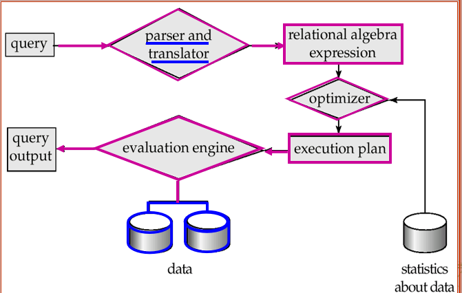

# Chapter 15: Query Processing


## 1. 查询过程的基本步骤

1. 解释和翻译(Parsing and translation)
2. 优化(Optimization)
3. 实现(Evaluation)



### 1.1 语法分析和翻译

类似于编译过程

- 解释器会检查语法规则，并验证关系是否存在...
- 将查询翻译为内部形式: **拓展关系代数 (ERA)**

### 1.2 优化

为什么需要优化:

- 对于给定的SQL查询, 可能有许多等价的关系代数表达式
- 每个关系代数操作可以等价的使用几种不同的算法

怎样进行优化:

- 寻找出等价的关系代数表达式
- 生成**查询执行计划**：一系列制定了详细执行策略的**原语操作(primitive operations)**序列
- 在所有等价的计划中选择 cost 最低的, 考虑两个因素:
	1. 成本取决于执行所用算法
	2. 成本基于**数据库目录**中的统计信息进行估算

### 1.3 实现

查询执行引擎接受一个查询执行计划，执行计划，并返回查询结果

---
## 2. 查询代价的度量

查询代价 通常用 回答查询所需的**总耗时**衡量

- 影响因素: 磁盘访问 + CPU + 网络通讯
- 通常**磁盘访问**是主要代价, 且相对容易估计

**磁盘访问**代价包括:

- seek 操作次数
- 读取的块数 $\times$ 平均块读取代价
- 写入的块数 $\times$ 平均块写入代价

> 写一个块通常比读一个块更贵, 因为写入后还需要读回验证写入是否成功

为了简化, 通常只使用以下两个指标:

- $t_T$: 传输一个块的时间, 约为 $0.1ms$
- $t_S$: 一次 seek 的时间, 约为 $4ms$

若有 $b$ 次 block transfer 和 $S$ 次 seek, 则代价为:
$$
b * t_T + S * t_S
$$

> 简化公式中忽略 CPU 代价, 也不计入最终查询结果写回磁盘的代价

影响代价估计的因素:

- 主存中 buffer 的大小
  - 内存越多, 磁盘访问需求越少
  - 但真实可用内存受并发进程影响, 很难提前确定
- 数据是否已经在 buffer 中
  - 若需要的数据已经在内存中, 可以避免磁盘 I/O
  - 但这也很难在代价估计时准确考虑

因此通常会估计:

- 最坏情况: 假设只有操作所需的最小内存
- 最好情况: 假设可用内存较充足

---

## 3. Selection Operation 选择操作

选择操作的目标是找到并取回满足选择条件的记录

### 3.1 基本算法: File Scan

**File scan**: 不使用索引, 直接搜索文件中满足条件的记录

**A1 linear search 线性搜索**:

- 扫描文件中的每个块
- 检查每条记录是否满足选择条件

代价估计:
$$
1\ seek + b_r\ t_T
$$

其中 $b_r$ 表示关系 $r$ 的文件块数

若选择条件在**key attribute**上:
$$
1\ seek + \frac{b_r}{2}\ t_T
$$
> 对于等值查询操作一般是$\frac{1}{2}$, 若是范围查询则仍需要扫描全部文件

> 线性搜索不依赖选择条件、文件中记录的顺序、是否存在索引, 因此总是可用

注意:

- 一般情况下 binary search 没有意义, 因为数据不一定连续存储
- 除非有索引, 否则 binary search 可能需要更多 seek, 反而不如 index search

### 3.2 使用索引和等值条件

**Index scan**: 使用 B+ tree 索引进行搜索

> selection condition 必须在 index 的 search-key 上

**A2 primary index on candidate key, equality**

利用主索引, 在码属性上做等值比较

- 最多取回一条满足条件的记录

代价:
$$
(H_i + 1) * (t_S + t_T)
$$

>其中 $H_i$ 为索引树高, 其中$H_i \times (t_S + t_T)$表示访问索引树的代价, +1表示的是访问真正数据块的代价


**A3 primary index on non-candidate key, equality**

利用主索引, 在非码属性上做等值比较

- 可能取回多条记录
- 因为主索引对应文件的物理顺序, 匹配记录通常在连续 block 上

代价:
$$
H_i * (t_T + t_S) + t_S + t_T * b
$$

其中 $b$ 为包含取回记录的块数, 由于记录连续, 所以只需要 1 次seek

**A4 equality on search-key of secondary index**

利用辅助索引做等值比较

1. 若 search-key 是 candidate key:
$$
(H_i + 1) * (t_T + t_S)
$$

2. 若 search-key 不是 candidate key:

- 可能取回多条记录
- 每条匹配记录可能位于不同 block

代价:
$$
(H_i + n) * (t_T + t_S)
$$

其中 $n$ 为匹配记录数

> 辅助索引在返回大量记录时可能非常贵, 甚至比 linear scan 更差

### 3.3 涉及比较的选择

比较符包括:

- $>, \geq, <, \leq, <>$

与等值比较不同, 比较选择通常会返回一个范围

**A5 primary index, comparison**

基于主索引的比较, 假设关系在属性 $A$ 上排序

- 对于 $\sigma_{A \geq V}(r)$:
  - 使用索引找到第一个 $A \geq V$ 的 tuple
  - 然后顺序扫描关系
- 对于 $\sigma_{A \leq V}(r)$:
  - 直接从文件开头顺序扫描到第一个 $A > V$ 的 tuple
  - 通常不使用索引

**A6 secondary index, comparison**

基于辅助索引的比较

- 对于 $\sigma_{A \geq V}(r)$:
  - 用索引找到第一个 $A \geq V$ 的 index entry
  - 顺序扫描 leaf nodes 到末尾
  - 根据指针取回记录
- 对于 $\sigma_{A \leq V}(r)$:
  - 从 leaf pages 开始扫描, 直到遇到第一个 $A > V$
  - 根据指针取回记录

> 辅助索引的范围查询可能对每条记录产生一次 I/O, 若取回记录很多, linear file scan 可能更便宜, 因为seek的次数可能少得多

### 3.4 复杂选择的实现

**合取选择 Conjunction**:
$$
\sigma_{\theta_1 \land \theta_2 \land ... \land \theta_n}(r)
$$

**A7 conjunctive selection using one index**

1. 从 $\theta_1, ..., \theta_n$ 中选择代价最低的条件先执行
2. 将取回的元组放入内存
3. 在内存中测试其他条件

> 先用最便宜的条件缩小候选集合, 再检查剩余条件

**A8 conjunctive selection using composite index**

如果存在合适的**组合索引(composite index)**, 可以直接使用

例如:

```sql
create index a_bb on account(branch_name, balance);
```

则对于同时涉及 `branch_name` 和 `balance` 的条件, 可以使用该组合索引

**A9 conjunctive selection by intersection of identifiers**

通过 record pointer 的交集实现合取选择

1. 对每个有索引的条件, 使用对应索引取回 record pointers
2. 对这些 pointer 集合求交集
3. 对交集结果排序
4. 按 pointer 从文件中取回记录
5. 没有索引的条件在内存中测试

> 先合并指针, 再取数据, 可以减少大量随机取记录的代价

**析取选择 Disjunction**:
$$
\sigma_{\theta_1 \lor \theta_2 \lor ... \lor \theta_n}(r)
$$

**A10 disjunctive selection by union of identifiers**

- 若所有条件都有可用索引:
  - 分别取得每个条件对应的 record pointers
  - 对 pointer 集合求并集
  - 再取回记录
- 若并非所有条件都有索引:
  - 使用 linear scan

**否定 Negation**:
$$
\sigma_{\neg \theta}(r)
$$

实现方式:

- 直接 linear scan
- 或将否定条件改写为可使用索引的形式

例如:
$$
\sigma_{\neg(A < 50)}(r) \Rightarrow \sigma_{A \geq 50}(r)
$$

---

## 4. Sorting 排序

排序的用途:

- 用户要求查询结果按某种顺序输出
- 某些 join 操作可以在排序后更快实现

可通过索引按顺序读关系, 但这只是**逻辑有序**, 并不保证物理连续, 可能导致每个 tuple 都访问一个磁盘块

排序方法:

- 若关系能放入内存, 可使用 quicksort 等内存排序算法
- 若关系不能放入内存, 使用 **external sort-merge 外部排序归并**

### 4.1 External Sort-Merge 外部排序归并

设:

- $M$: 内存可容纳的 block 数
- $b$: 关系总 block 数
- run: 排序过程中产生的中间子文件, 也称为**归并段**

**Step 1: 创建 sorted runs**

重复执行直到关系读完:

1. 将关系的 $M$ 个 blocks 读入内存
2. 在内存中排序
3. 将排序结果写入 run $R_i$

初始 run 数:
$$
N_0 = \lceil \frac{b}{M} \rceil
$$

**Step 2: Merge the runs**

使用 $M - 1$ 个 buffer 作为输入 run 的缓冲区, 剩下 1 个 buffer 作为输出

- 每次从各输入 buffer 中选择当前最小记录写入输出 buffer
- 输入 buffer 空时, 读取对应 run 的下一块
- 输出 buffer 满时, 写回磁盘

若初始 run 数 $N_0 \geq M$, 需要多轮 merge pass

- 每一轮将连续的 $M - 1$ 个 runs 合并成一个新 run
- 每一轮使 run 的数量减少约 $M - 1$ 倍

merge pass 数:
$$
\lceil \log_{M-1}(\frac{b}{M}) \rceil
$$

### 4.2 外部排序代价

每一轮 run generation 和 merge pass 都需要读写全部数据, 代价约为 $2b$

最终 pass 不计入最终写回结果的代价(可以一边归并一边被上层调用)

block transfer 总代价:
$$
2b_r(\lceil \log_{M-1}(\frac{b_r}{M}) \rceil + 1) - b_r
$$

即:
$$
b_r(2\lceil \log_{M-1}(\frac{b_r}{M}) \rceil + 1)
$$

seek 代价:

$$
2\lceil \frac{b_r}{M} \rceil + \lceil \frac{b_r}{b_b} \rceil(2\lceil \log_{M-1}(\frac{b_r}{M}) \rceil - 1)
$$

---

## 5. Join Operation 连接操作

常见 join 算法:

- Nested-loop join
- Block nested-loop join
- Indexed nested-loop join
- Merge-join
- Hash-join

### 5.1 Nested-Loop Join 嵌套循环连接

用于计算 theta join:
$$
r \bowtie_\theta s
$$

基本思想:

```text
for each tuple tr in r:
    for each tuple ts in s:
        if (tr, ts) satisfy θ:
            output tr · ts
```

- $r$ 称为 outer relation
- $s$ 称为 inner relation
- 不需要索引
- 可用于任何 join condition
- 代价高, 因为需要检查两个关系中的每一对 tuple

**最坏情况**, 内存只能容纳每个关系各一个 block:

block transfer:
$$
n_r * b_s + b_r
$$

seek:
$$
n_r + b_r
$$
> 这里假设 $s$ 可以顺序读, 所以每次只需要 seek $s$ 的开头就可以

**最好情况**, 较小关系能完全放入内存:

block transfer:
$$
b_r + b_s
$$

seek:
$$
2
$$

### 5.2 Block Nested-Loop Join

block nested-loop join 是 nested-loop join 的改进:

- 每次不是用 outer relation 的一个 tuple, 而是用一个 block
- inner relation 的每个 block 与 outer relation 的每个 block 配对: 即将r block中的所有tuple 比较一遍后再更换s block
```text
for each block Br in r:
    for each block Bs in s:
        for each tuple tr in Br:
            for each tuple ts in Bs:
                if tr 和 ts 满足 join 条件:
                    输出连接结果
```

**最坏情况:**
- block transfer
$$
b_r * b_s + b_r
$$

- seek:
$$
b_r + b_r = 2 * b_r
$$

> 通常选择 block 数较少的关系作为 outer relation

**最好情况,** inner relation 全部且始终在内存中:
- block transfer
$$
b_r + b_s
$$

**改进**:
- 若内存大小为 $M$ 个 blocks, 可以用 $M - 2$ 个 blocks 作为 outer relation 的 blocking unit:

block transfer:
$$
\lceil \frac{b_r}{M-2} \rceil * b_s + b_r
$$

seek:
$$
2\lceil \frac{b_r}{M-2} \rceil
$$

- 若是 equi-join, 且 join attribute 是 inner relation 的 key, 找到第一个匹配后即可停止 inner loop
- inner loop 可交替向前/向后扫描, 利用 LRU 策略下 buffer 中残留的块
```text
对 outer 第 1 批 blocks：
    正向扫描 inner：S1, S2, S3, S4

对 outer 第 2 批 blocks：
    反向扫描 inner：S4, S3, S2, S1

对 outer 第 3 批 blocks：
    正向扫描 inner：S1, S2, S3, S4
```
- 若 inner relation 有索引, 可使用 indexed nested-loop join

### 5.3 Indexed Nested-Loop Join

使用条件:

- join 是 equi-join 或 natural join
- inner relation 的 join attribute 上有索引
	- 若没有索引, 可以临时为 join 构建索引

**基本思想:**

- 对 outer relation $r$ 中的每个 tuple $t_r$
- 使用 inner relation $s$ 上的索引查找满足 join 条件的 tuple

最坏情况:
$$
n_r * c + b_r
$$

> 其中:
	-  $c$ : 对 $s$ 做一次索引查找并取回所有匹配 tuple 的代价
	- $n_r$ : outer relation 的 tuple 数

若使用 B+ tree 索引:
$$
c = H_i + 1
$$

因此:
$$
cost = [n_r * (H_i + 1) + b_r] * (t_T + t_S)
$$

若两个关系的 join attribute 上都有索引: 
- 选择 tuple 数更少的关系作为 outer relation

### 5.4 Merge-Join / Sort-Merge Join 排序归并连接

只适用于:
- equi-join
- natural join

**基本步骤:**

1. 若两个关系尚未按 join attribute 排序, 先排序
2. 对两个已排序关系进行归并
3. 对 join attribute 相同的 tuple 进行匹配

若关系已经有序, 且相同 join attribute 值对应的所有 tuple 能放入内存:
- 那么每个 block 通常只需要读一次
- block transfer:
$$
b_r + b_s
$$

- seek:
$$
\lceil \frac{b_r}{b_b} \rceil + \lceil \frac{b_s}{b_b} \rceil
$$

若关系未排序, 需要额外加上排序代价

**Hybrid merge-join 混合归并连接**:

适用情况:

- 一个关系已经排序
- 另一个关系在 join attribute 上有 secondary B+ tree index

思路:

1. 将已排序关系与 B+ tree leaf entries 做 merge join
2. 得到结果 $(t_r, P_s)$, 其中 $P_s$ 是未排序关系 tuple 的地址
3. 按地址 $P_s$ 排序
4. 按物理地址顺序扫描未排序关系, 将地址替换为实际 tuple

> 因为顺序扫描通常比大量随机查找更高效

### 5.5 Hash-Join 哈希连接

适用于:
- equi-join
- natural join

**分区(partition)**:
分区阶段:
- 内存需要为每个分区开创一个分配一个block, 当其写满就写回disk的临时文件中
- 此外还需要一个 input buffer

设:

- $H_{r0}, H_{r1}, ..., H_{rn}$ 为关系 $r$ 的分区
- $H_{s0}, H_{s1}, ..., H_{sn}$ 为关系 $s$ 的分区

若:
$$
i = h(t_r[JoinAttrs])
$$

则:
$$
t_r \in H_{ri}
$$

分区的 **BT cost**：
- block transfer：$2\times b_r$
- seek: $2\frac{b_r}{b_b}$

核心思想:

- 使用 hash function $h$ 根据 join attribute 对两个关系分区
- 若两个 tuple 的 join attribute 相同, 它们一定会被分到相同编号的 partition 中
- 因此只需要在对应分区之间做 join


**Join BT cost**:
- block transfer: $b_r + b_s$
- seek: $2\times b_h$
### 5.6 Hash-Join Algorithm

1. **Partition 阶段:** 使用 hash function $h$ 分别对 $r$ 和 $s$ 分区
2. **Probe 阶段:** 
   - 对每个分区编号 $i$:
   - 将 $H_{si}$ 读入内存
   - 在 $H_{si}$ 上基于 join attribute 建立内存 hash index
   - 逐个读取 $H_{ri}$ 中的 tuple
   - 使用内存 hash index 查找匹配的 $H_{si}$ tuple
   - 输出连接结果

> 通常选择较小的关系作为 build input, 因为 build partition 需要放入内存

**分区时的内存限制:**

- 每次分区个数 $n_h \leq M - 1$
- 每个 build partition 的大小必须 $\leq M - 2$, 因为 build input 要被读入内存

> 若 build partition的大小 $> M-2$逻辑上也可以实现, 不过因为 无法将$H_s$全部装入buffer中, 会使得运行效率大幅降低, 所以我们要求使用的 hash function 可以让每个 build partition 的大小 $\leq M-2$

> 当 $n_h$ 过大, 会使得 $n_h \leq M-1$; 当 $n_h$ 过小, 可能使得$分区大小 \geq M-2$

若 partition 太大, 需要 **recursive partitioning 递归分区**

- 使用不同 hash function 继续划分过大的 partition
- $r$ 和 $s$ 必须使用相同方式继续分区

### * 5.7 Hash-Join Overflow

### 5.8 Hash-Join 代价

若不需要 recursive partitioning:

**block transfer:**
$$
3(b_r + b_s) + 4n_h
$$

其中:

- 分区阶段读写两个关系: $2(b_r + b_s)$
- join 阶段再读两个关系: $(b_r + b_s)$
- $4n_h$ 用于估计每个分区部分块不满带来的额外代价

**seek:**
$$
2(\lceil \frac{b_r}{b_b} \rceil + \lceil \frac{b_s}{b_b} \rceil) + 2n_h
$$

若需要 recursive partitioning, 且对 $s$ 分区的 pass 数为:
$$
\lceil \log_{M-1}(b_s) - 1 \rceil
$$

总 block transfer:
$$
[2(b_r + b_s)\lceil \log_{M-1}(b_s) - 1 \rceil + b_r + b_s] * t_T
$$

seek cost:
$$
[2(\lceil \frac{b_r}{b_b} \rceil + \lceil \frac{b_s}{b_b} \rceil)\lceil \log_{M-1}(b_s) - 1 \rceil + 2n_h] * t_S
$$

最好情况:

- 整个 build input 可以放入内存
- 不需要产生临时分区文件

代价下降为:
$$
b_r + b_s
$$

### * 5.9 Hybrid Hash-Join

### 5.10 Complex Joins

**合取连接条件**:
$$
r \bowtie_{\theta_1 \land \theta_2 \land ... \land \theta_n} s
$$

实现方式:

1. 使用 nested-loop 或 block nested-loop 先计算其中一个较简单的 join:
$$
r \bowtie_{\theta_i} s
$$
2. 对中间结果测试其他条件:
$$
\theta_1 \land ... \land \theta_{i-1} \land \theta_{i+1} \land ... \land \theta_n
$$

**析取连接条件**:
$$
r \bowtie_{\theta_1 \lor \theta_2 \lor ... \lor \theta_n} s
$$

可分别计算每个 join, 然后求并:
$$
(r \bowtie_{\theta_1} s) \cup (r \bowtie_{\theta_2} s) \cup ... \cup (r \bowtie_{\theta_n} s)
$$

---

##  * 6. Other Operations 其他操作


---

## 7. Evaluation of Expressions 表达式求值

前面讨论的是单个关系代数操作的算法, 实际查询通常是一棵包含多个操作的 expression tree

对整棵表达式树的求值有两种主要方式:

- Materialization 实体化: 直接产生表达式的结果, 并写回disk; 每步操作都产生一个temp
- Pipelining 流水线: 边产生tuple边将其传入上层供使用

### 7.1 Materialization 实体化

**Materialized evaluation**:

- 一次执行一个操作
- 从 expression tree 的最低层开始
- 每个操作的结果写入临时关系
- 上层操作再读取这些临时关系继续执行

优点:

- 总是可用
- 实现方式直接

缺点:

- 中间结果写磁盘再读回, 代价可能很高

总代价:
$$
各个操作代价之和 + 中间结果写入磁盘的代价
$$

优化: **Double buffering**

- 每个操作使用两个输出 buffer
- 一个 buffer 满时写入磁盘
- 另一个 buffer 继续接收输出

> 可以重叠磁盘写入和计算, 减少执行时间

### 7.2 Pipelining 流水线

**Pipelined evaluation**:

- 多个操作同时执行
- 一个操作产生的 tuple 不写入临时关系, 而是直接传给父操作

优点:

- 通常比 materialization 更便宜
- 避免中间关系写磁盘

限制:

- 并非所有操作都能流水线执行
- 取决于父操作类型、输出是否有序、算法是否能边读入边输出

流水线执行方式:

- demand driven / lazy evaluation 需求驱动: 由上而下吸引
- producer driven / eager pipelining 生产者驱动: 由下而上推动

### 7.3 三种常见查询执行模型

**Iterator Model / Volcano Model / Pipeline Model**

又称:

- 火山模型
- 流水线模型
- pull based 执行模型

核心思想:

- 将关系代数中的每个操作抽象为一个 Operator
- 整个 SQL 被构造成 Operator tree
- 查询树自顶向下调用 `next()`
- 数据自底向上被拉取处理

优点:

- 简单
- 每个 Operator 可以单独实现逻辑

缺点:

- `next()` 调用次数过多
- 一次只取一条 tuple, CPU 执行效率低
- join, subquery, order by 等操作经常会阻塞

**Materialization Model**

- 每个 Operator 一次处理所有输入
- 处理完成后一次性输出所有结果
- 更适合 OLTP 负载, 因为 OLTP 查询通常只访问小规模数据

**Vectorized / Batch Model**

- 类似火山模型, 每个 Operator 也实现 `next()`
- 但每次 `next()` 返回一批 tuples, 而不是一个 tuple

> 向量化模型是火山模型和物化模型的折中, 更适合 OLAP 查询, 可以显著减少 Operator 调用次数
