# Chapter 6: Entity-Relationship Model 实体-联系模型

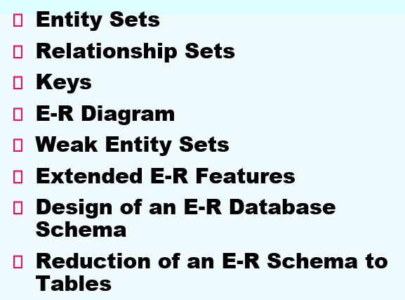

## 1. Entity Sets 实体集

真实世界可以 modeled 为:

- **实体(entities)** 的collection
- 实体间的**relationships(联系)**

一个实体是客观存在, 并且可以相互区分的事物

实体拥有**属性(attributes)**

- 例如: 学生 拥有 id, name, age...

**实体集** 是**拥有相同性质的相同类型的**实体的集合

### Attributes 属性

属性是**描述性的性质**

**Domain(域, value set)** 是属性可行值的集合

属性的类型:

- 简单与复合属性
- 单值和多值属性
- 派生(derived)属性: 可以从其它属性介绍而来
  - 基属性, 存储属性

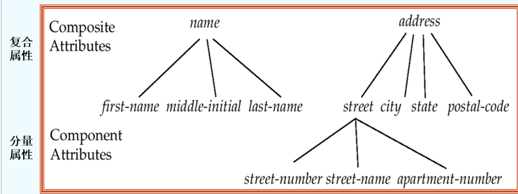

## 2. Relationship Sets 联系集

**联系** 是不同类实体之间的关联

**联系集 relationship set**是相同类型联系的集合

一个联系集包含多个同类联系(或联系实例, relationship instance)

一个联系集表示两个或多个实体集之间的关联

**属性**同样可以是联系集的性质

### 1. Degree of a Relationship Set

**Degree** 为联系集中实体集的个数

- 涉及两个实体集的是**binary**(或者 degree two) (二元联系)

### 2. Mapping Cardinalities 映射基数

一个联系集中, 一个实体可以和另一类实体相联系的实体数目

多用于描述二元联系集

例如:

- One to one (1:1), 如: 就任总统(总统, 国家)
- One to many (1:n), 如: 分班情况(班级, 学生)
- Many to one (n:1), 如, 就医(病人, 医生)
- Many to many (n:m), 如, 选课(学生, 课程)

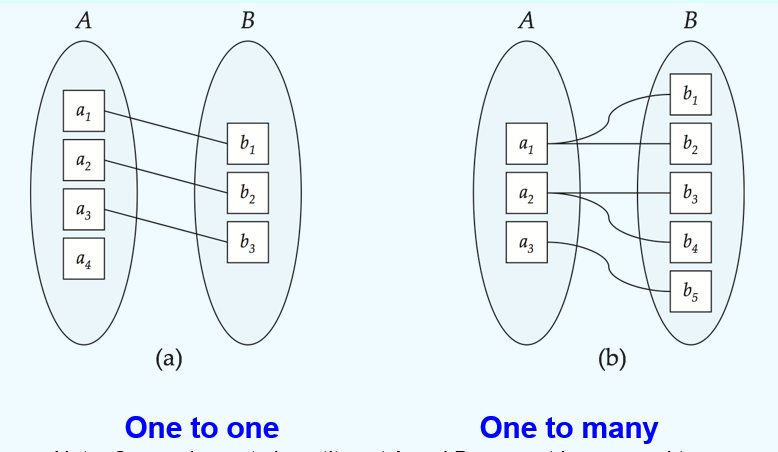

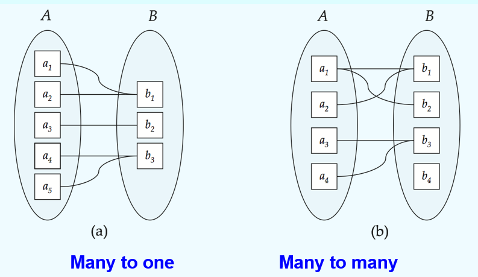

>  实体集中的一些元素可能不能mapping到另一个集合中的任何元素

## 3. Keys (码, 键)

> 实体集的keys

- **super key(超码)**
- **candidate key(候选码)**
- **primary key**

**关系集**的keys:

- 参与一个联系集的各实体集的主键的组合, 构成该联系集的**超码**

  - 这意味着, 一对实体在一个特定的关系集中, 最多拥有一种关系
  - 通俗来讲: 如果想要唯一标识一次关系, 需要知道是谁 和 谁

  

- 当决定联系集的candidate key时, 需要考虑联系集的映射基数

  - 多对多 (m:n)
    - 比如：学生选课。一个学生选多门课，一门课有多个学生。
    - **主键**：必须是两端实体主键的组合 `(学生ID, 课程ID)`。因为单靠学生ID找不到唯一的课，单靠课程ID也找不到唯一的学生。

  - 一对多 (1:n)
    - 比如：部门与员工。一个部门有多个员工，一个员工只有一个部门。
    - **主键**：只需要“多”的那一端的主键，即 `员工ID`。因为只要确定了员工，也就唯一确定了他是哪个部门的，不需要再把部门ID加进主键里。

  - 一对一 (1:1)
    - 比如：员工和工位。一个员工坐一个工位，一个工位坐一个员工。
    - **主键**：任意一端的主键都可以，比如 `员工ID` 或 `工位ID`。

- 若有多个候选键, 选择主码时, 需要考虑关系集的语义
  - 例如: 作为码的属性不能为空, 值不应常变

## 4. E-R Diagrams

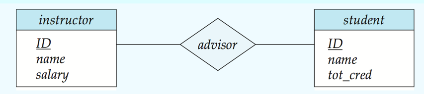

- **分割的Rectangles** 代表实体集; 蓝色部分代表实体集名称, 白色部分代表实体集的各部分属性
- **Diamonds** 代表联系集
- **未分割的矩形**代表关系集的属性, 作为主键的一部分带有下划线

- **线条**将实体集连接到关系集。
- **虚线**将关系集的属性连接到该关系集。
- **双线**表示实体在关系集中的完全参与（总参与）。
- **双菱形**表示连接到弱实体集的标识性关系集。

### 1 复合, 多值, 派生属性 E-R图

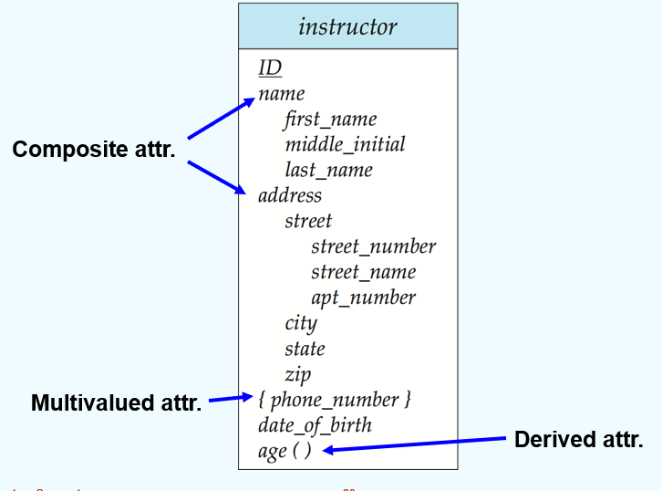

### 2. 带有属性的联系集合

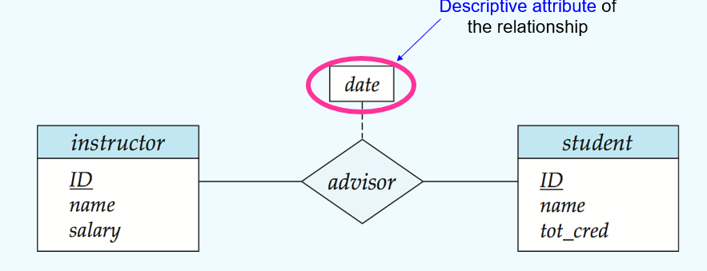

### 3. Roles

一个联系的实体集不需要是不同的: **Recursive relationship set 自环联系集**

**Role**: 实体在关系中扮演的功能

**角色标签**: 可选, 用于阐明关系的语义

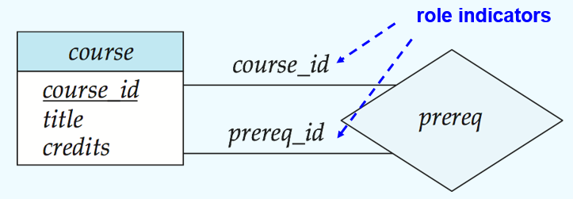

### 4. Express the Cardinality Constraints 基数约束

**带方向的箭头**: 表示 one

**不带方向的箭头**: 表示 many

**1. one-to-one relationship**:

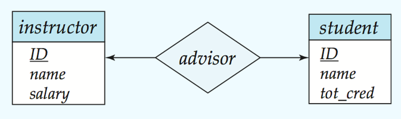

**one-to-many relationship**:

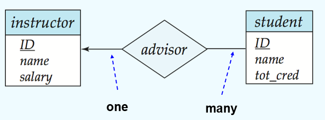

### 5. Participation of an Entity Set in a Relationship Set 参与约束

**全参与(Total participation)**: 用 double line 指明

**部分参与(Partial participation)**: 一些实体可能不参与联系集中的任何联系

- 映射基数约束, 限定了一个实体与发生关联的另一端实体可能关联的数目上限
- 全参与与部分参与约束, 则反应一个实体参与关联的数目下限: 0 or 1

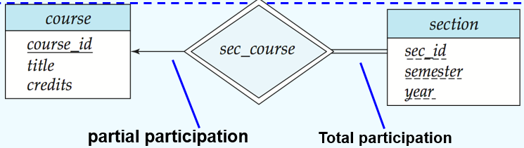

### 6. Alternative Notation for relationship Constraints

数字区间表示法: `min..max`

- `*` 表示无穷多

### 7. Ternary Relationship 三元关系

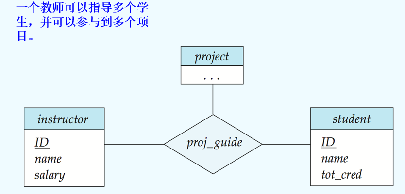

一些 non-binary 联系 可能能被 binary 联系更好的表示

- 例如: parents(he, she, child) 可以被 father(he, child), mother(she, child)表示

但是有一些联系自然的是non-binary

**Converting**:

通过创建一个**人工实体集**, 可以实现convert

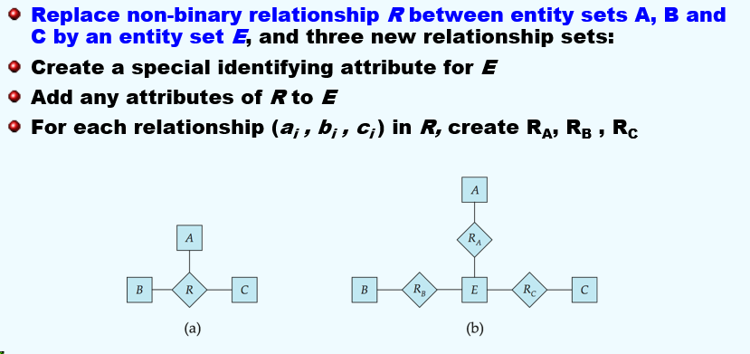

---

## 5. Weak Entity Sets 弱实体集

**弱实体集**: 没有一个主键

弱实体集的存在依赖于**标识实体集(identifying entity set) 或 属主实体集(owner entity set)**存在

- 它必须通过从标识实体集到弱实体集的 **完全（total）**、**一对多（one-to-many）** 关系集与标识实体集相关联。

相关关系被称为 **标识性联系（identifying relationship）**（标识性联系）

**分辨符(discriminator)或部分码(partial key)** 是弱实体集中 用于与依赖同一强实体集的其它弱实体集相区分的部分属性

**弱实体集的主键**通过自己的分辨符+依赖的强实体集的主键构成

## 6. Extended E-R features

### 1. Stratum of the entity set 层

**特殊化 (Specialization)**

- **自顶向下的设计过程**；我们在一个实体集内指定一些子分组，这些子分组在该集合中具有区别于其他实体的独特性。
- 这些子分组成为**较低层次的实体集**，它们拥有的属性或参与的关系**并不适用**于较高层次的实体集。
- **属性继承** —— 较低层次的实体集继承与其关联的较高层次实体集的所有属性和关系参与。

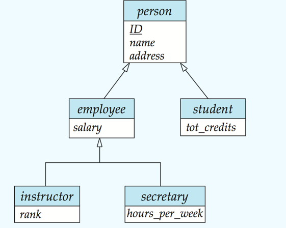

 **泛化** （泛化、普遍化）

- **一种自底向上的设计过程** —— 将多个具有相同特征的实体集合并为一个更高层级的实体集。
- **特化（Specialization）和泛化（Generalization）互为简单的逆过程**；它们在 E-R 图中的表示方式相同。
- **术语“特化”和“泛化”通常互换使用**。

**特化/泛化**（即实体继承关系）的两个关键**设计约束**:

1. 约束一：如何决定谁属于哪个子类？

- 条件定义的
  - **含义**：这是自动的、基于数据的判断。系统会根据实体某个属性的值，自动把它归类。

- 用户定义的
  - **含义**：这是手动的、由人决定的。分类不取决于某个具体的属性值，而是由管理员或用户根据业务逻辑来分配。

2. 约束二：一个实体能不能同时属于多个子类？

- 不相交

  - **含义**：互斥。一个实体**只能**属于一个子类，不能脚踏两只船。

- 可重叠

  - **含义**：兼容。一个实体**可以**同时属于多个子类。

    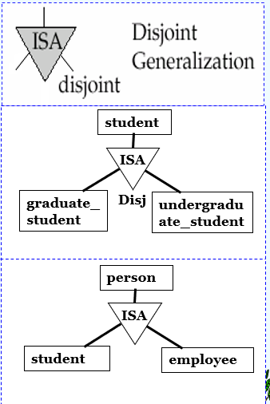

**完全性约束**（Completeness constraint）指定在泛化中，高层实体集中的实体是否**必须**属于至少一个低层实体集。

- **全部（total）**：一个实体必须属于其中一个低层实体集 （完全泛化）
- **部分（partial）**：一个实体不必属于其中一个低层实体集 （部分泛化）

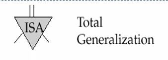

### 2. Aggregation 聚集, 合并

- 将关系视为抽象实体
- 允许关系之间存在关系
- 将关系抽象为新的实体

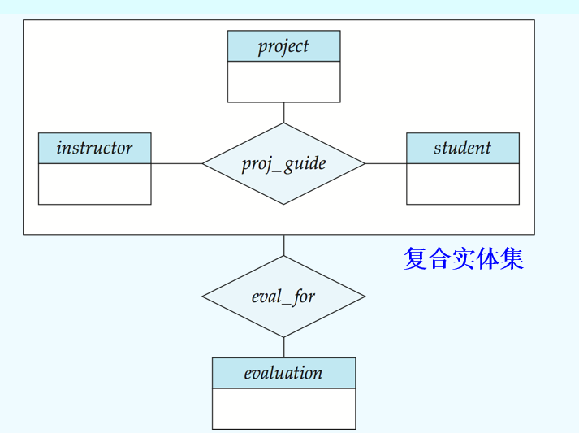

---

### E-R Notation 总结

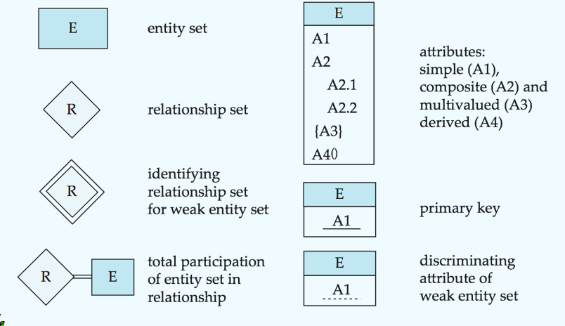

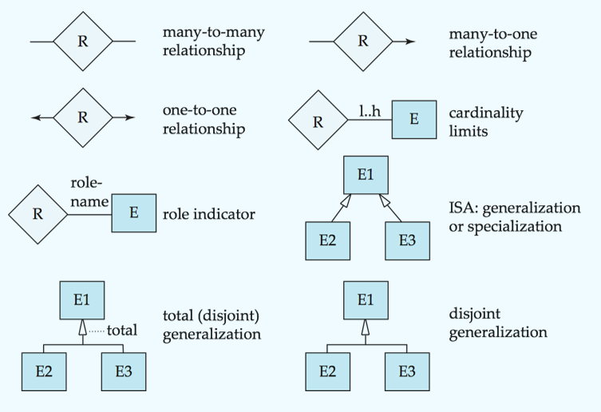

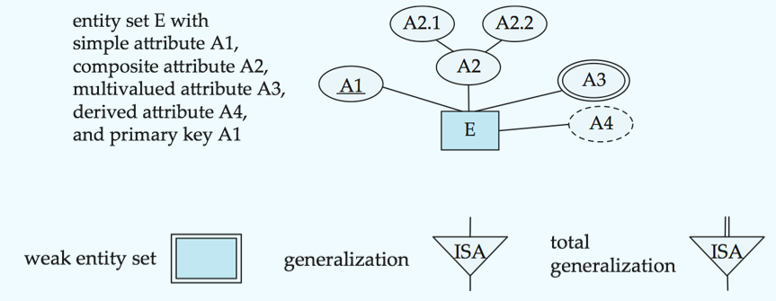

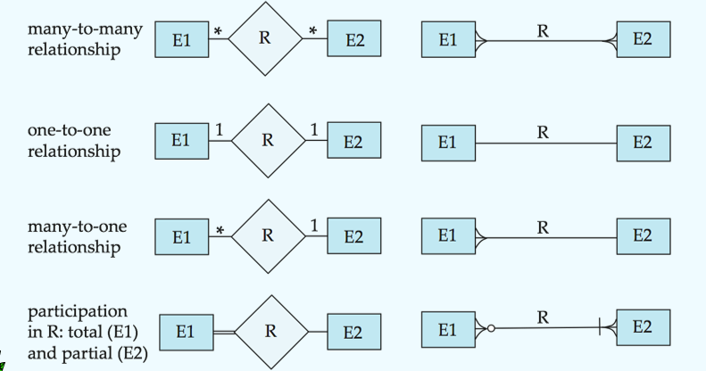

## 7. Design of an E-R database schema

### 1. 数据库设计步骤

1. 需求分析
2. 概念数据库设计
   - 使用E-R模型对数据和约束进行高级描述

3. 逻辑数据库设计
   - 将概念设计转化为数据库模式: `table`

4. 物理数据库设计

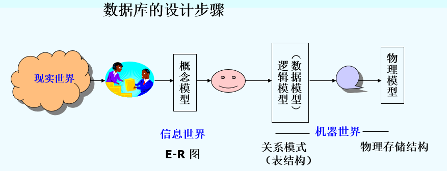

### 2. E-R设计考虑

1. 使用一个 attribute 还是 entity set 表示一个object?

   - 若一个对象只对其名字及单值感兴趣, 则可作为属性, 如: 性别

   - 若一个对象除名字外, 本身还有其他属性需要描述, 则该对象应定义为实体集, 如: 电话 ,住址

   - 一个对象不能同时作为实体和属性

   - 一个实体集不能和另一个实体集的属性相关联, 只能实体与实体相关联

2. 使用 entity set 还是 relationship set?

   - 联系集: 描述两个对象之间发生的动作

   - 映射基数会影响

3. attribute of an entity 还是 relationship

   - 要从对象的语义独立性和减少数据冗余考虑

4. 三元 还是 n元联系 与 一对二元联系
5. 使用强实体集或弱实体集
6. 使用特化/泛化
7. 使用聚合

## 8. 逻辑设计 - 将E-R表转化为数据库表

符合 E-R 图的数据库可以用一组表来表示

对于每个 实体集 和 关系集, 都有一个唯一的表, 该表被赋予相应实体集或关系集的名称

### 1. 用表表示实体集

强实体集 ==> 拥有相同属性的表

**1.1 复合属性**:

**复合属性通过为每个分量属性创建单独的属性来进行扁平化处理**

- **例如**，给定实体集 ***instructor***，其包含复合属性 ***name***，而 ***name*** 又包含分量属性 ***first-name*** 和 ***last-name***。那么对应于该实体集的表将包含两个属性：
  *name.first-name* 和 *name.last-name*
  或者
  *first-name* 和 *last-name*

**1.2 多值属性**:

多值属性不能直接放在主实体表中, 必须拆分出一个独立的表

- 例如, 对于 instructor(ID, name, salary, **phone_number**) ==> instructor(ID, name, salary), instructor_phone(ID, phone_number)

多值属性的每个值, 对应 EM表的一行

### 2. 表示弱实体集

**实体集表**包含: 标识强实体集的主键

### 3. 表示联系集

**联系集**被表示为一张表, 其列包含**两个参与实体集的主键(在这里作为外键)**, 以及联系集本身的任何描述性属性

### 4. Redundacy of Tables 表的冗余 => 表的合并

**1. many-to-one**

当两个实体集之间存在多对一关系, 且在 "多"的那一端是total participation时, 不需要建立独立的关系表, 直接在代表"多"的实体表中, 增加一列, 这一列的内容是"一"那一端实体表的主键

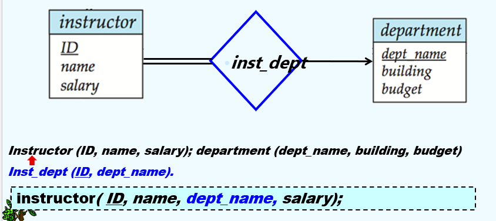

- 若多的一端是 *partial* , 新增的那一列属性值允许为 null

- 对于 one-to-one, 随意向一侧添加即可

**2. 弱实体集**

联系弱实体集及其标识性实体集的联系集对应的表是冗余的, 即对应 *identifying relationship* 的表是多余的

联系表 与 弱实体集的内容是完全一样的, 则可以省略联系集表

简单来说，**弱实体表天生就包含了它与强实体之间的联系信息，所以不需要额外的表来记录这种联系。**

### 5. 表示特化 Specialization

**Method_1**:

- 为高层实体形成一个模式
- 为每个低层实体集形成一个模式，包括高层实体集的主键和局部属性

| 模式 (schema) | 属性 (attributes)        |
| ------------- | ------------------------ |
| *person*      | *ID, name, street, city* |
| *student*     | *ID, tot_cred*           |
| *employee*    | *ID, salary*             |

- **缺点**：获取关于员工（employee）的信息需要访问两个关系，即对应低层模式的关系和对应高层模式的关系

**Method_2**:

- 为每个实体集形成一个包含所有局部属性和继承属性的模式

| 模式 (schema) | 属性 (attributes)                      |
| :------------ | :------------------------------------- |
| **person**    | ***ID, name, street, city***           |
| **student**   | ***ID, name, street, city, tot_cred*** |
| **employee**  | ***ID, name, street, city, salary***   |

- **如果特化（specialization）是完全的（total），则不需要通用实体集（person）的模式来存储信息**
- 可以定义为一个“视图（view）”关系，包含特化关系的并集
- 但是为了外键约束，可能仍然需要显式的模式
- **缺点：** 对于既是学生又是员工的人，***name\*、\*street\* 和 \*city*** 可能会被冗余存储
