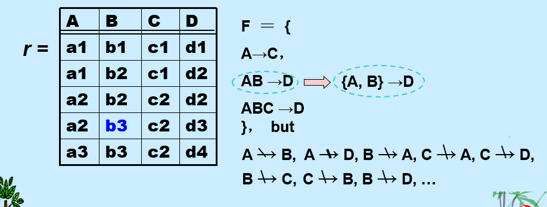
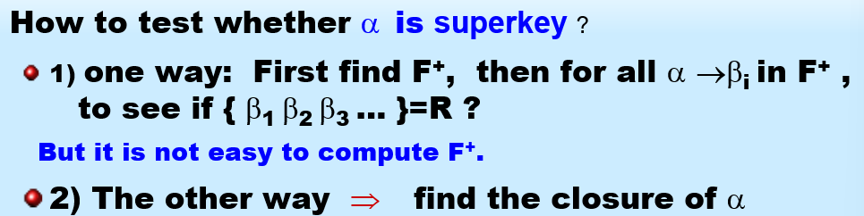
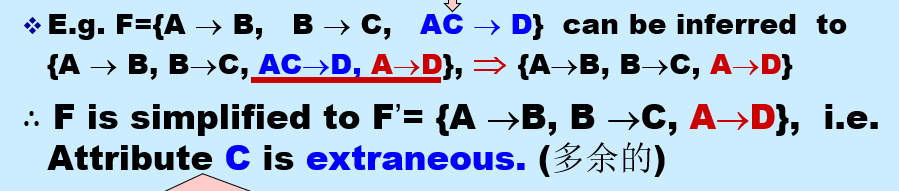
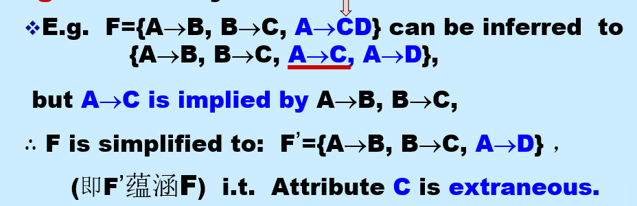
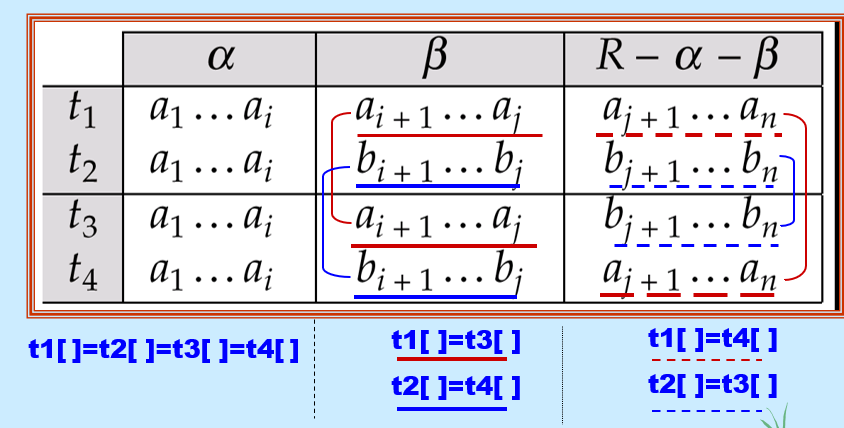

# Relational Database Design


## 1. First Normal Form 第一范式

如果域的元素被认为是不可分割的单位，则该域是 **原子的**。

- 非原子域的例子：
  - 复合属性 - 姓名集合
  - 多值属性 - 一个人的电话号码
  - 复杂数据类型 - 面向对象

如果关系模式 R 的所有属性的域都是 **原子的**，则称该关系模式 R 属于 **第一范式 (1NF)**。

对于关系数据库，要求所有关系都必须满足 1NF。

怎样处理非原子性值:

- 对于复合属性: 使用多个属性
- 对于多值属性: 
  1. 使用多个字段, 即在一个表中预留多个列
  2. 使用独立的表: 创建一个新的关系表, 专门用来存储这个多值属性
  3. 使用单个字段: 在一个字段中使用分隔符把多个值拼在一起

坚持使用非原子数据的缺点:

- 使存储变得复杂
- 导致数据冗余
- 查询变得复杂

**原子性实际上是域中元素如何使用的一种属性**

- 例如：字符串通常被认为是不可分割的
- 假设分配给学生的学号是形式为 *CS0012* 或 *EE1127* 的字符串
- 如果提取前两个字符来确定系别，那么学号的域就不是原子的。
- 这样做是个坏主意： 会导致信息编码在 应用程序 中，而不是在数据库中。

## 2. Pitfalls in Relational Database Design 关系数据库设计中的陷阱

糟糕的设计可能导致: 数据冗余, 插入 删除 修改异常

### Decomposition 分解

主要的精炼技术: **分解**
$$
R = R_1 \cup R_2
$$
**无损连接分解**: 

 目标 — 为以下内容设计一个理论

 - 判断特定关系 R 是否处于“好”的形式。 -无冗余

 - 如果关系 R不处于“好”的形式，将其分解为一组关系 {R1,R2,...,Rn}使得
 - 每个关系都处于好形式
   - 该分解是无损连接分解

 - 我们的理论基于：

   - **函数依赖 (functional dependencies)**
   - **多值依赖 (multivalued dependencies)**

## 3. Functional Dependencies 函数依赖

### 3.1. Definition

**函数依赖**: 一种完整性约束, 表示特定属性值之间的关系, 可用于**判断模式规范化**并**提出改进建议**

借用了数学上的函数概念$x \rightarrow f(x)$

函数依赖是**键概念**的推广

- 对于关系模式 R, 若 K 是一个超键, 当且仅当 K --> R, 即K确定时, R一定能够确定
- 若K 是一个候选键, 当且仅当:
  - K --> R
  - 没有 K 的子集$\alpha$ , 使得 $\alpha$ --> R

函数依赖 可以表达出**使用超键无法表达**的完整性约束

函数依赖的**作用**:

1. 在给定函数依赖集合 F 下, 测试关系是否是合法的
   - 如果关系r是合法的, 称作**r satisfies F**

2. 通过函数依赖, 为关系集(schema)指明**完整性约束**

   - F 在 R 上成立(F holds on R), 如果R上的所有合法关系$r_s$都满足函数依赖集合F

   - 容易判别一个r是否满足给定的F; 但是不易判别F是否在R上成立, 不能仅由某个r推断出F; R上的函数依赖F, 通常由定义R的语义决定

**平凡依赖(trivial) 与 非平凡依赖(non-trivial)**:

- 如果一个函数依赖满足所有关系, 则它是**平凡的(trival)**
  - 例如 $A\rightarrow A$
  - 一般的, 如果$\beta \subseteq \alpha$, 则$\alpha \rightarrow \beta$ 是平凡的; 否则, 它是不平凡的

### 3.2. Closure of a Set of Functional Dependencies 函数依赖集的闭包

给定**函数依赖集合 F**, 存在其它一些由 **F 逻辑蕴含** 的函数依赖

- 例如, 给定$A \rightarrow B and B\rightarrow C$, 则可以推断出$A \rightarrow C$

**定义**: 所有由**F 逻辑蕴含**的函数依赖集合, 称为**F 的闭包**, 记作$F^+$

- 例如 

  ```
  F={A→B,B→C}
  ```

  那么 

  ```
  F+={A→B,B→C,A→C,A→A,AB→A,AB→B,AC→C,A→BC,...}
  ```


**Armstron's Axioms(公理)**:

- 这个公理提供了寻找$F^+$的参考规则

- 公理内容:

  - reflexivity 自反律: 若 $\beta \subseteq \alpha$, 则 $\alpha \rightarrow \beta$ ---- 平凡的
  - augmentation 增补律: 若$\alpha \rightarrow \beta$, 则$\gamma\alpha\rightarrow\gamma\beta$, $\gamma\alpha\rightarrow\beta$

  - transitivity 传递律: 若$\alpha \rightarrow \beta$, 并且 $\beta\rightarrow\gamma$, 那么$\alpha\rightarrow\gamma$

- 这些公理是: sound(保真的), complete(完备的)
- 补充定律: 为了简化计算可以使用这些附加规则

  - If $\alpha \rightarrow \beta$ and $\alpha \rightarrow \gamma$ holds, then $\alpha \rightarrow \beta\gamma$ holds **(union, 合并律)**
  - If $\alpha \rightarrow \beta\gamma$ holds, then $\alpha \rightarrow \beta$ and $\alpha \rightarrow \gamma$ holds **(decomposition, 分解律)**  
  - If $\alpha \rightarrow \beta$ and $\gamma\beta \rightarrow \delta$ holds, then $\alpha\gamma \rightarrow \delta$ holds **(pseudotransitivity, 伪传递律)**

- 对于 n 个属性, 可能的最大函数依赖数量是$2^n \times 2^n$

### 3.3. Closure of Attribute Sets 属性集的闭包



**定义**: 对于给定属性集$\alpha$, 在F下由$\alpha$所直接或间接函数决定的属性集合称为$\alpha^+$

- 测试$\alpha \rightarrow \beta$在$F^+$中, $\Leftrightarrow$ $\beta\subseteq\alpha^+$
- 测试$\alpha$是一个超键: $\alpha\rightarrow R$在$F^+$中 $\Leftrightarrow$ $R\subseteq \alpha^+$

**属性闭包的使用**:

- 测试超键
- 测试函数依赖
- 计算函数依赖集闭包

### 3.4. Canonical Cover 正则覆盖

DBMS 应该始终检查以确保不违反 F 中的任何函数依赖(FD); 但是若 F 太大, 检查成本很高, 因此我们需要简化函数依赖集

**F 的规范覆盖**(记作$F_c$) 是一个 **与F等价的最小函数依赖集**

- 没有冗余的FD, 且没有冗余的FD部分, 即不包含任何外来属性

> **外来属性 (Extraneous Attribute)：** 指一个函数依赖 $X \to Y$ 中，如果移除 $X$ 中的某个属性 $A$（变成 $X - \{A\}$），或者移除 $Y$ 中的某个属性 $B$（变成 $Y - \{B\}$），且移除后所得到的函数依赖仍然可以从原始函数依赖集推导出来，那么 $A$ 或 $B$ 就是外来属性。规范覆盖要求左侧和右侧都没有这样的外来属性。
>
> 形式化表示: $F' = (F-\{\alpha\rightarrow \beta\})\cup\{(\alpha-A)\rightarrow\beta\}$, 其中F'与F等价, 即说明A是α中的外来属性

- 每个函数依赖的左侧是唯一的

得到 $F_c$ $\Rightarrow$ 删除多余属性

- 对多余属性有三种情况:

  1. 函数依赖集可能包含**冗余依赖**, 这些依赖可以从其它依赖中推断出来
  2. 部分函数依赖的**左侧**可能是冗余的 $\Rightarrow$ 外来属性

  3. 部分函数依赖的**右侧**可能是冗余的

## 4. Decomposition 分解

### 4.1. 规范化的目标

判断一个特定的关系R是否是好的形式: 没有冗余, 插入 删除 更新 无异常

将不是好形式的关系 R, 分解为一组关系{R1, R2, ..., Rn}, 使得:

- 无损连接分解
- 依赖保持
- 每个关系Ri 是好的形式

### 4.2 分解应有的特性

1. 原关系模式R中的所有属性, 必须在分解中出现, 即 $R = R_1 \cup R_2$
2. 无损分解
   - 无损分解当且仅当, $F^+$中至少满足以下依赖中的一个: $\{R_1\cap R_2\}\rightarrow R_1$ 或者 $\{R_1\cap R_2\}\rightarrow R_2$
   - 这个条件意味着, 分解后的两个子模式, 必须共享一个足够强的属性集, 使得这个共享属性集能够唯一确定其中一个子模式的所有属性

3. Dependency preservation 依赖保持
   - 为了高效的检查更新(以确保不违反任何FD), 允许在子关系 Ri 中分别进行更新验证, **无需它们的连接操作**
   - F 对 Ri 的限制是: $F_i \subseteq F^+$, 其中$F_i$是$F^+$中只包含$R_i$中属性的依赖集合
   - $(F_1 \cup F_2 \cup ... \cup F_n)^+ = F^+$

4. 无冗余: 关系Ri最好处于BCNF 或 3NF

## 5. Boyee-Codd Normal Form

> **关系模式**是基础，它定义了可以存储的数据结构。**函数依赖集**是对这种数据结构的约束。**BCNF** 则是衡量这种数据结构在满足约束的情况下，是否存在冗余和异常的一个“质量标准”。

**定义**: 一个处于BCNF中的关系模式 R, 对于函数依赖集F来说, 如果对于$F^+$中**所有形如$\alpha \rightarrow \beta$的函数依赖**, 以下条件至少有一个成立:

- $\alpha \rightarrow \beta$是平凡的
- $\alpha$ 是 R 的超键

任何两个属性的关系范式都处于BCNF

> 可以在F下判别R是否违反BCNF, 但必须在F+下判别R的分解式是否违反BCNF

不能总是满足所有三个设计目标:

- 无损链接
- BCNF
- 依赖保持

**BCNF 分解算法**:

```
主循环: 遍历查找result集合中每一个关系模式Ri, 检查是否满足BCNF条件
	- 若找到一个Ri:
		1. 选择一个违规依赖 α -> β
		2. 将其分解为 Rnew1 = α ∪ β
					Rnew2 = (Ri - β) ∪ α
```


## 6. Third Normal Form: Motivation

存在一些情况:

- 分解为BCNF不保持依赖
- 但是高效地检查更新时的FD违规很重要

$\Rightarrow$定义一个较弱的范式, 称为**第三范式**

- 允许一些冗余
- 但函数依赖可以在单个关系上检查, 无需计算连接
- **总是存在**一个无损链接, 依赖保持的3NF分解

**定义**: 处于第三范式的关系 R, 对于所有的F+中的 $\alpha \rightarrow \beta$, 至少满足下面的一个:

- $\alpha \rightarrow \beta$是平凡的
- $\alpha$是R的超键
- $\beta - \alpha$中的每个属性A都包含在R的某个候选键中 $\Rightarrow$ 为主属性
  - 这是 3NF 相对于BCNF 放松的关键条件, 是对BCNF的最小化放松, 以确保依赖保持 

若一个关系处于BCNF, 那么它也处于3NF

测试是否满足 3NF:

- 只需要检查F中的FDs, 不需要检查F+中的所有FD
- 对于每组依赖, 使用**属性闭包**检查α是否是超键
- 若α不是一个超键, 验证β中的每个属性是否是R中候选键的部分属性
  - 这个检查是相当昂贵的, 因为涉及到寻找候选键
  - 已经被证实是一个NP-hard问题

**3NF 分解算法**

```
result初始为空
1. 计算F的规范覆盖Fc
2. 为Fc中的每一个函数依赖, 检查是否有模式已经包含了α∪β
	-- 检查是否需要为当前依赖新建一个关系模式, 若已经有了就不需要了, 避免冗余
3. 若没有: 创建新的关系模式, Ri = α∪β
4. 若目前已经创建的所有模式都不包含R中的任何一个候选键, 创建Ri = 任意一个候选键
	-- 确保无损连接
```

## 7. Mutivalued Dependencies 多值依赖

> 对于 classes(course, teacher, book), 其处于BCNF, 但是由于 teacher 和 book 是多值属性, 所以可能会导致冗余 与 插入异常
>
> 所以最好将其分解为 teaches(course, teacher) , book (course, book)

**多值依赖 定义**: 对于关系模式 R , $\alpha,\beta \subseteq R$, 若 存在多值依赖 $\alpha\rightarrow\rightarrow \beta$:

*   对于 `α` 的**任何一个特定值**（比如 "数据库" 课程），它所关联的 `β` 值（比如 "Avi" 老师和 "Hank" 老师）
*   和它所关联的 `Z` 值（比如 "DB Concepts" 和 "DB System (Ullman)" 两本书）是**完全独立**的。
*   **这意味着什么？** 这意味着 `α` 的每一个值所对应的 `β` 的每一个值，都必须和 `α` 的每一个值所对应的 `Z` 的每一个值**组合出现**。

**表格表示**:

若$\beta\subseteq\alpha$ 或者 $\alpha\cup\beta = R$, 那么多值依赖是**平凡的**

若将关系 R 分为 Y Z W 三个部分, 若$Y\rightarrow\rightarrow Z$, 那么 $Y\rightarrow\rightarrow W$

若$\alpha\rightarrow\beta$, 那么$\alpha\rightarrow\rightarrow \beta$

依赖集D的关系闭包D+, 是由 D 逻辑蕴含的**函数依赖** 与 **多值依赖**的集合

### 7.1 第四范式

 对于处于第四范式的关系模式 R ,若对于D+中的所有多值依赖$\alpha\rightarrow\rightarrow\beta$, 至少满足一点:

- 这个依赖是平凡的
- α是R的超键

若 关系处于 第四范式, 那么它处于BCNF

### 7.2 分解的要求

- 假设关系 R 被分解成 R₁, R₂, ..., Rₙ，并且每个 Rᵢ 都需要符合 4NF

- **D 对 Rᵢ 的限制（Dᵢ）是由以下依赖组成的集合：**
  - D⁺ 中所有只包含 Rᵢ 属性的**函数依赖**
  - 形式为 α →→ (β ∩ Rᵢ) 的所有**多值依赖,** 其中 α 是 Rᵢ 的子集，并且 α →→ β 在 D⁺ 中

### 7.3 4NF 分解算法

```
主循环:
	- 若找到一个不符合4NF的关系模式,且α∩β为空(为了确保无损连接), 执行分解步骤
	- 将Ri分解为 (α, β) 与 (Ri - β)
```

## 8 Overall Database Design Process 数据库设计过程

我们假设关系模式 R 已给定:

- R 可能是通过将 E-R 图转换为一组表时生成的
- R 可能是一个包含所有相关属性的单一关系（称为通用关系）
- 规范化将 R 分解成更小的关系

- R 可能是某些临时（ad hoc）关系设计的结果，我们随后对其进行测试/转换为范式

### E-R图 和 规范化

- 当 E-R 图经过精心设计，** **正确识别了所有实体时，从 E-R 图生成的表应该不需要进一步规范化

- 然而，在实际（不完美）的设计中，实体中非键属性之间可能存在函数

- 关系集（relationship set）中**非键属性的函数依赖**(非键属性决定了实体中另一个非键属性)是可能的，但很少见 --- 大多数关系是二元的

### 通用关系方法

**Dangling tuples 无归属元组**: 在计算 join 时 "消失"的元组

关系 `r₁ ⋈ r₂ ⋈ ... ⋈ rₙ` 被称为**通用关系**，因为它包含了由 `R₁ ∪ R₂ ∪ ... ∪ Rₙ` 定义的“宇宙”中的所有属性
